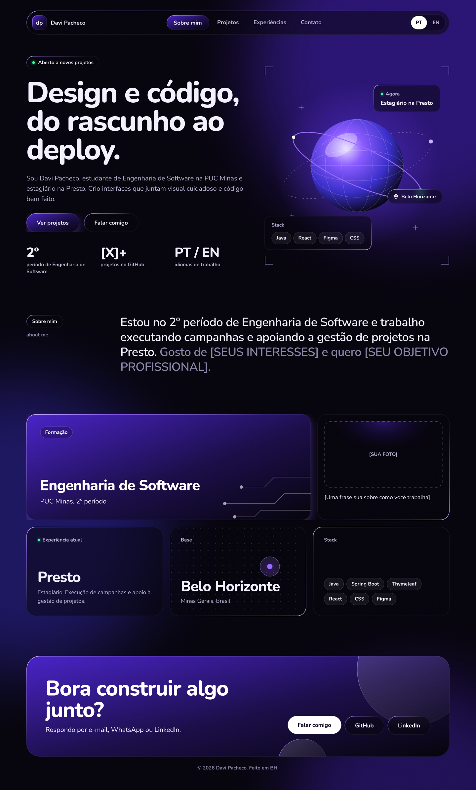
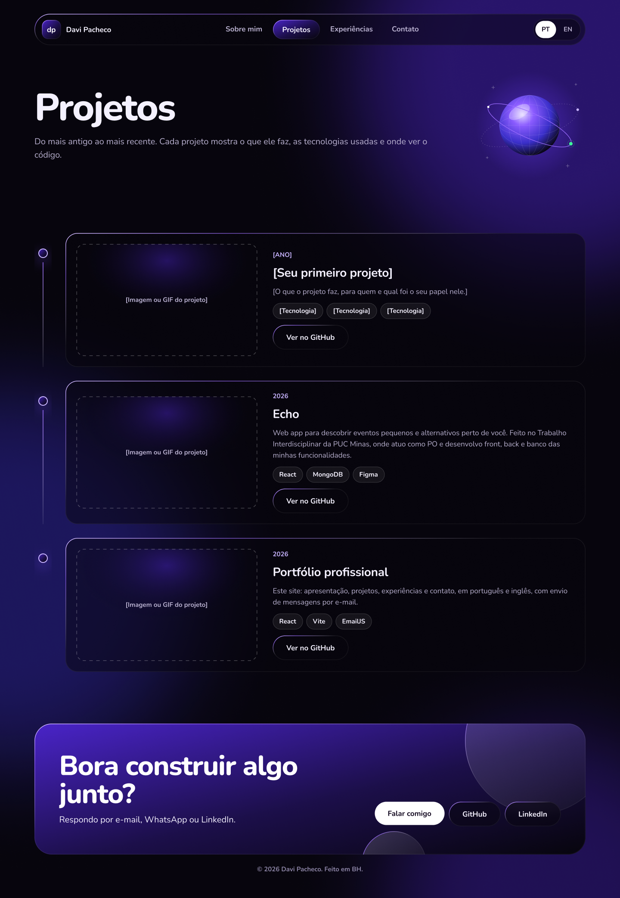
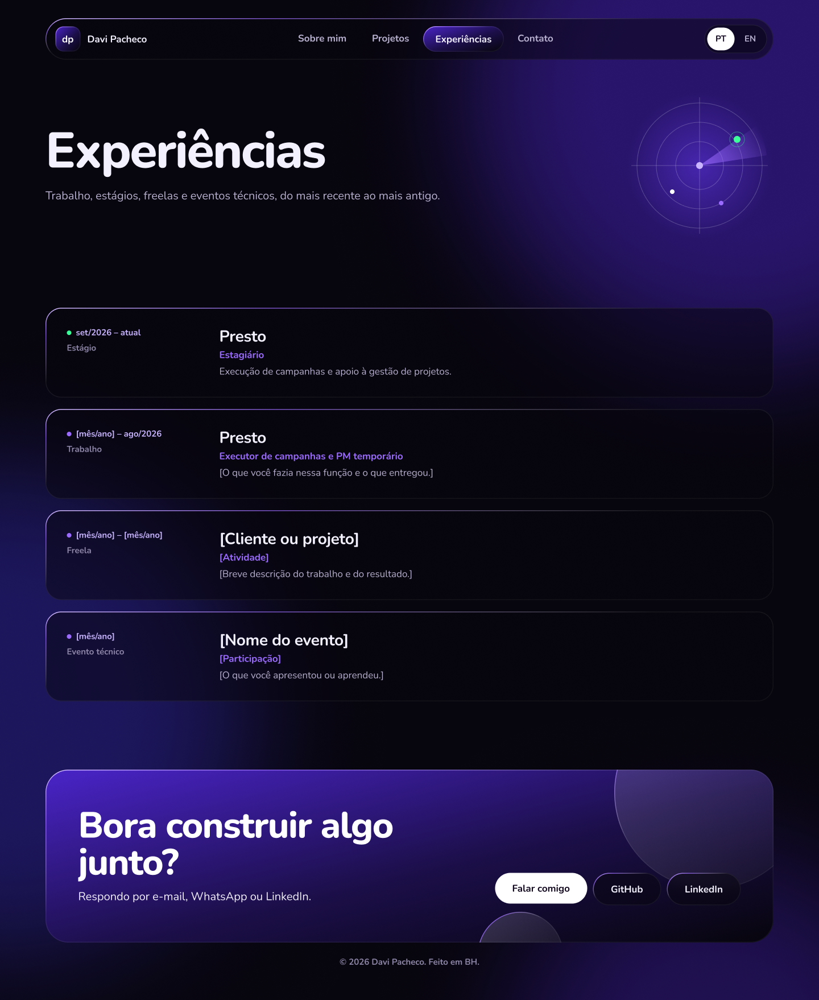
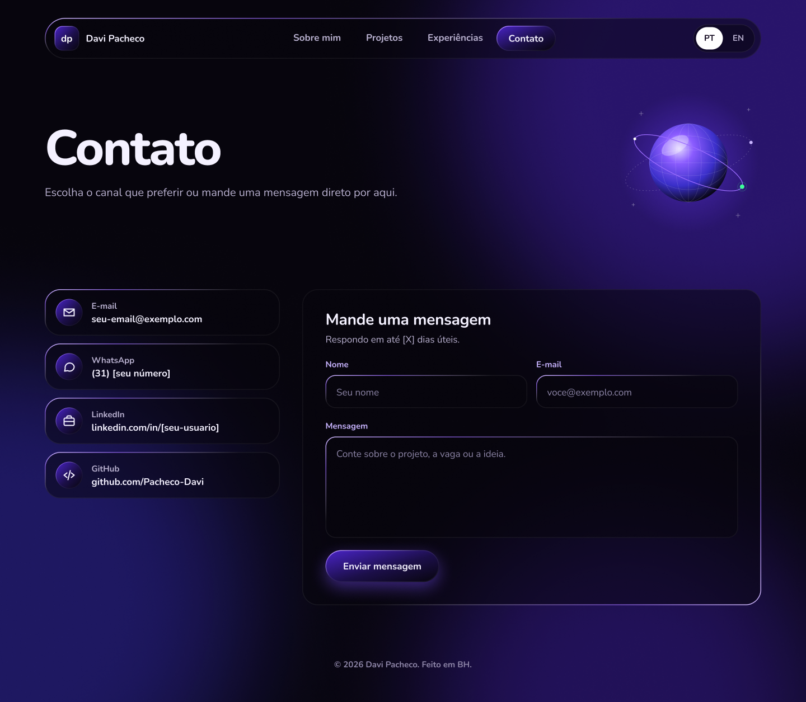
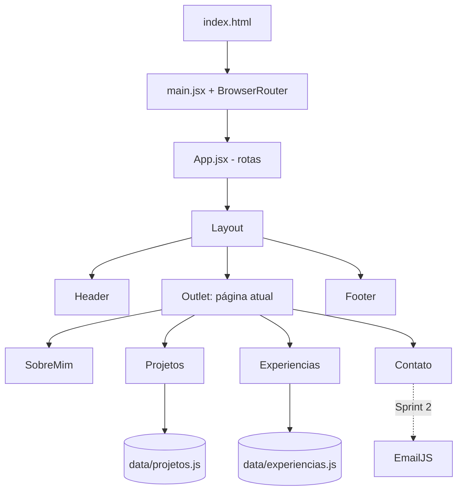

# 🏷️ Portfólio Profissional — Davi Pacheco 👨‍💻

> [!NOTE]
> Website de portfólio pessoal para apresentar trajetória, projetos, experiências e formas de contato de maneira moderna, responsiva e acessível.
> Laboratório 01 da disciplina **Desenvolvimento e Integração de Aplicações Web (DIAW)** — Engenharia de Software, PUC Minas.

---

## 🚧 Status do Projeto

-yellow?style=for-the-badge)


| Sprint | Entrega | Status |
| :--- | :--- | :---: |
| **Lab01S01** | Planejamento, wireframes, navegação e layout base | ✅ Em entrega |
| **Lab01S02** | Funcionalidades: PT/EN, timeline dinâmica, formulário funcional, validações | ⏳ Planejado |
| **Lab01S03** | Deploy na Vercel, imagens/GIFs dos projetos, README final | ⏳ Planejado |

---

## 📚 Índice
- [Links Úteis](#-links-úteis)
- [Sobre o Projeto](#-sobre-o-projeto)
- [Funcionalidades Principais](#-funcionalidades-principais)
- [Protótipos (Wireframes)](#-protótipos-wireframes)
- [Tecnologias Utilizadas](#-tecnologias-utilizadas)
- [Arquitetura](#-arquitetura)
- [Instalação e Execução](#-instalação-e-execução)
- [Deploy](#-deploy)
- [Estrutura de Pastas](#-estrutura-de-pastas)
- [Demonstração](#-demonstração)
- [Documentações utilizadas](#-documentações-utilizadas)
- [Autores](#-autores)
- [Agradecimentos](#-agradecimentos)
- [Licença](#-licença)

---

## 🔗 Links Úteis
* 🌐 **Demo Online:** _em breve (deploy na Vercel na Sprint 3)_
  > 💻 **Descrição:** Link para o site em produção, hospedado gratuitamente na Vercel.
* 🎨 **Protótipos no Figma:** [Acessar wireframes](<LINK-DO-FIGMA>)
  > 📐 **Descrição:** Wireframes de média fidelidade das quatro páginas do site.

---

## 📝 Sobre o Projeto

Este projeto é um **website de portfólio profissional** desenvolvido no contexto acadêmico da disciplina DIAW (PUC Minas). Ele existe para reunir, em um único lugar, quem eu sou, o que já construí e como falar comigo — funcionando como um "cartão de visitas" técnico para recrutadores, professores e potenciais parceiros.

**Problema que resolve:** currículos em PDF não mostram projetos funcionando. O portfólio permite exibir telas, GIFs, código-fonte e uma linha do tempo da evolução profissional, além de oferecer um canal direto de contato.

**Público-alvo:** recrutadores de tecnologia, professores e contatos profissionais.

---

## ✨ Funcionalidades Principais

- 🧭 **Navegação entre páginas:** menu fixo no topo com indicação da página ativa e versão mobile (menu recolhível).
- 👤 **Sobre Mim:** apresentação com formação, área de atuação, interesses e objetivos, em **português e inglês** _(alternância de idioma na Sprint 2)_.
- 🗂️ **Projetos:** linha do tempo do mais antigo ao mais recente, com nome, descrição, tecnologias, link do GitHub e imagem/GIF.
- 💼 **Experiências:** empresa/instituição, cargo, período e descrição de cada experiência.
- 📨 **Contato:** ícones clicáveis (e-mail, WhatsApp, LinkedIn, GitHub) e formulário com nome, e-mail e mensagem, com envio por e-mail via **EmailJS** _(Sprint 2)_.
- 📱 **Design responsivo:** layout adaptado para desktop, tablet e celular.
- ♿ **Acessibilidade:** foco visível no teclado, link "pular para o conteúdo" e respeito à preferência de movimento reduzido.

---

## 🎨 Protótipos (Wireframes)

Wireframes de média fidelidade criados no **Figma**.

| Sobre Mim | Projetos |
| :---: | :---: |
|  |  |
| **Experiências** | **Contato** |
|  |  |

### Identidade visual

A paleta é inspirada nos **azulejos azul e branco da Pampulha**, em Belo Horizonte — uma referência à minha cidade e uma forma de dar personalidade ao site sem perder a sobriedade profissional.

| Token | Cor | Uso |
| :--- | :---: | :--- |
| `--azul` | `#1F4E9C` | Cabeçalho, links, botões |
| `--azul-escuro` | `#12305F` | Títulos, rodapé |
| `--azul-claro` | `#DCE6F5` | Fundo dos azulejos, tags |
| `--papel` | `#FAFAF7` | Fundo da página |
| `--texto` | `#1A2233` | Texto principal |

**Tipografia:** *Bricolage Grotesque* (títulos) e *Source Sans 3* (texto), via Google Fonts.

---

## 🛠 Tecnologias Utilizadas

### 💻 Front-end

* **Biblioteca:** React 18.3.1
* **Linguagem:** JavaScript (ES6+) e JSX
* **Roteamento:** React Router DOM 6.26.2
* **Estilização:** CSS puro com variáveis (Custom Properties)
* **Ícones:** React Icons 5.3.0
* **Build Tool:** Vite 5.4.8
* **Internacionalização (previsto – Sprint 2):** react-i18next
* **Envio de e-mail (previsto – Sprint 2):** EmailJS

### 🖥️ Back-end

Não há back-end próprio. O envio de e-mail do formulário será feito pelo **EmailJS**, um serviço que dispara e-mails direto do front-end, dispensando servidor.

### ⚙️ Infraestrutura & DevOps

* **Cloud:** Vercel (hospedagem gratuita de sites estáticos/SPA)
* **Versionamento:** Git + GitHub
* **Design/Prototipação:** Figma

### 📦 Dependências

| Pacote | Versão | Tipo | Finalidade |
| :--- | :---: | :---: | :--- |
| `react` | 18.3.1 | dependência | Construção da interface em componentes |
| `react-dom` | 18.3.1 | dependência | Renderização do React no navegador |
| `react-router-dom` | 6.26.2 | dependência | Navegação entre páginas (SPA) |
| `react-icons` | 5.3.0 | dependência | Ícones de contato e redes sociais |
| `vite` | 5.4.8 | dev | Servidor de desenvolvimento e build |
| `@vitejs/plugin-react` | 4.3.1 | dev | Suporte a JSX e Fast Refresh no Vite |

---

## 🏗 Arquitetura

O site é uma **SPA (Single Page Application)** em React: o navegador carrega um único `index.html` e o **React Router** troca o conteúdo da área central conforme a URL, sem recarregar a página.

- **`Layout`** — componente "moldura" que contém `Header`, `Footer` e um `<Outlet />`, onde a página atual é encaixada. Assim, cabeçalho e rodapé são escritos uma única vez.
- **`pages/`** — uma página por seção do menu (`SobreMim`, `Projetos`, `Experiencias`, `Contato`).
- **`components/`** — peças reutilizáveis (`Header`, `Footer`, `PageHeader`).
- **`data/`** — conteúdo de projetos e experiências separado da interface. Para adicionar um projeto, basta editar o arquivo de dados; a timeline se monta sozinha.

**Fluxo:** URL → React Router → `Layout` → página correspondente → componentes → dados.



**Decisões:** Vite foi escolhido pela velocidade de desenvolvimento; CSS puro com variáveis mantém o projeto leve e sem dependências extras; o arquivo `vercel.json` redireciona todas as rotas para o `index.html`, evitando erro 404 ao recarregar páginas internas na Vercel.

---

## 🔧 Instalação e Execução

### Pré-requisitos
* **Node.js:** versão LTS (v18.x ou superior)
* **Gerenciador de pacotes:** npm

### 📦 Instalação de Dependências

```bash
git clone https://github.com/Pacheco-Davi/portfolio.git
cd portfolio
npm install
```

### ⚡ Como Executar a Aplicação

```bash
npm run dev
```
🎨 *O site estará disponível em **http://localhost:5173**.*

### 🔑 Variáveis de Ambiente (Sprint 2)

Crie um arquivo **`.env.local`** na raiz do projeto para a integração com o EmailJS:

```
VITE_EMAILJS_SERVICE_ID=seu_service_id_aqui
VITE_EMAILJS_TEMPLATE_ID=seu_template_id_aqui
VITE_EMAILJS_PUBLIC_KEY=sua_public_key_aqui
```

> Variáveis em projetos **Vite** precisam começar com `VITE_` para ficarem disponíveis no código do front-end.

---

## 🚀 Deploy

Planejado para a **Sprint 3**, na **Vercel**:

```bash
npm run build      # gera a pasta /dist com os arquivos estáticos
npm run preview    # simula a versão de produção localmente
```

Na Vercel: importar o repositório do GitHub → framework **Vite** detectado automaticamente → configurar as variáveis de ambiente do EmailJS → deploy.

---

## 📂 Estrutura de Pastas

```
.
├── docs/
│   └── wireframes/          # 🎨 Imagens dos wireframes do Figma
├── public/
│   └── favicon.svg          # 🖼️ Ícone da aba do navegador
├── src/
│   ├── components/          # 🧱 Componentes reutilizáveis
│   │   ├── Header.jsx       #    Menu de navegação (desktop e mobile)
│   │   ├── Footer.jsx       #    Rodapé com links sociais
│   │   ├── Layout.jsx       #    Moldura: header + conteúdo + footer
│   │   └── PageHeader.jsx   #    Título padrão de cada página
│   ├── pages/               # 📄 Uma página por seção do menu
│   │   ├── SobreMim.jsx
│   │   ├── Projetos.jsx
│   │   ├── Experiencias.jsx
│   │   └── Contato.jsx
│   ├── data/                # 🗂️ Conteúdo separado da interface
│   │   ├── projetos.js
│   │   └── experiencias.js
│   ├── styles/
│   │   └── global.css       # 🎨 Tokens de design e estilos globais
│   ├── App.jsx              # 🧭 Definição das rotas
│   └── main.jsx             # 🚪 Ponto de entrada da aplicação
├── index.html               # 📄 HTML base da SPA
├── vercel.json              # ☁️ Redirecionamento de rotas na Vercel
├── vite.config.js           # ⚙️ Configuração do Vite
├── package.json             # 📦 Dependências e scripts
└── README.md                # 📘 Este arquivo
```

---

## 🎥 Demonstração

### 🌐 Aplicação Web (Sprint 1 — layout base)

| Desktop | Mobile |
| :---: | :---: |
|  |  |

> GIFs dos projetos em execução serão adicionados na Sprint 3.

---

## 🔗 Documentações utilizadas

* 📖 [Documentação oficial do **React**](https://react.dev/reference/react)
* 📖 [Guia do **Vite**](https://vitejs.dev/guide/)
* 📖 [Documentação do **React Router**](https://reactrouter.com/)
* 📖 [**React Icons**](https://react-icons.github.io/react-icons/)
* 📖 [**EmailJS**](https://www.emailjs.com/docs/)
* 📖 [**Conventional Commits**](https://www.conventionalcommits.org/en/v1.0.0/)

---

## 👥 Autores

| 👤 Nome | :octocat: GitHub | 💼 LinkedIn | 📤 E-mail |
|---------|-----------------|-------------|-----------|
| Davi Pacheco | <div align="center"><a href="https://github.com/Pacheco-Davi"></a></div> | <div align="center"><a href="https://www.linkedin.com/in/SEU-USUARIO"></a></div> | <div align="center"><a href="mailto:seu-email@exemplo.com"></a></div> |

---

## 🙏 Agradecimentos

* [**Engenharia de Software PUC Minas**](https://www.instagram.com/engsoftwarepucminas/) — pelo apoio institucional e estrutura acadêmica.
* [**Prof. Dr. João Paulo Aramuni**](https://github.com/joaopauloaramuni) — pela orientação na disciplina DIAW e pelo template deste README.

---

## 📄 Licença

Este projeto é distribuído sob a **Licença MIT**.
